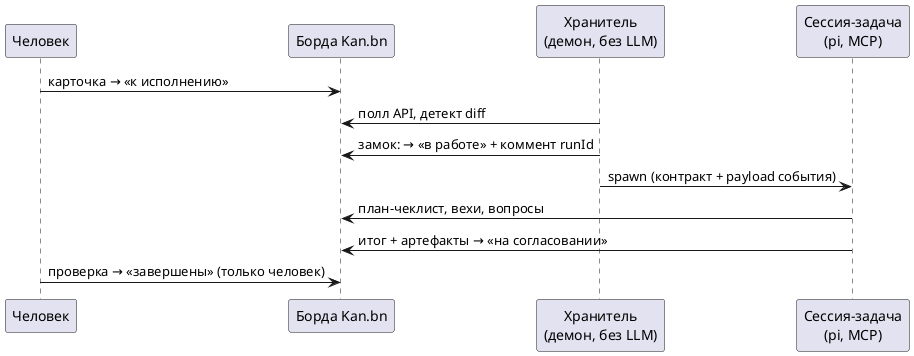

# pi-kan

**Доска Kan.bn как рабочий интерфейс coding-агента.** Хранитель-демон следит за бордой, будит сессии-задачи, а весь диалог «человек ↔ агент» живёт комментариями на карточках — там же, где вы ставите задачи людям.

> Тот же чат, но на доске. Только исполнитель не забывает контекст, не уходит в отпуск и работает из карточки, а не из пересказа в мессенджере.

## Зачем это нужно

Чат с агентом хорош для одной задачи в руках и плох для потока работы: задачи тонут в ленте, контекст живёт до закрытия вкладки, результат — где-то в логах, а прогресс приходится выпрашивать. Канбан-доска решает это с точностью до наоборот: очередь, статусы, вехи, аудит — всё штатно. **pi-kan соединяет доску с агентом**: карточка становится не списком «что сделать», а живым рабочим местом, где агент думает, делает и отчитывается.

Это особенно ценно для **команды**: на одной борде работают люди и агенты. Менеджер кидает карточку в «к исполнению», разработчик комментирует уточнение, агент берёт задачу, ведёт чек-лист этапами и кладёт готовое на «согласование» — каждый видит прогресс с телефона, ничего не теряется между ролями.

## Как это работает



**Карточка = задача, сессия = память задачи.** Карточка в очереди будит процесс агента с якорем `pi -p --session-id kan-<cardId>`. Между событиями процесс умирает, но контекст задачи остаётся в файле сессии: следующее пробуждение продолжает с полного рабочего состояния, а не с микротекста карточки. Одна карточка — одна активная сессия (замок по lockfile).

**Хранитель (keeper) — скрипт, не LLM.** Демон без модели опрашивает API борды, детектирует diff (карточка вошла в «к исполнению», человеческий коммент, правка описания, dueDate), сам ставит замок и спавнит сессию с payload-диффом события. Никакой интеллектуальной работы — только надёжный триггер. Вся мысль — в проснувшемся агенте.

**Борда — единственный реестр.** Никакой локальной базы задач: «в работе» = активные сессии, «на согласовании» = ждут человека, «завершены» ставит только человек. Состояние переживает смерть любой сессии, рестарт машины и апгрейды.

**Контракт пробуждения** — должностная инструкция, инжектируемая в каждый ход: борда — единственный канал связи с человеком; чек-лист отмечается сразу по факту, а не пачкой в конце; долгая работа уходит в фон с вехой «запущено, ETA»; результаты субагентов — файлами в карточку, не пересказом. Мандат жёсткий: максимум, куда агент вправе переместить карточку, — «на согласовании».

## Что это даёт процессу разработки

- **Очередь входящих для агентов.** Люди передают работы агентам той же доской, которой передают их людям: карточка, описание, сроки. Никакого «скинь промпт в личку».
- **Прогресс без микроменеджмента.** Чек-лист = этапы, чеканятся по мере выполнения; значимый этап — веховый коммент. С телефона видно, где задача, не дёргая исполнителя.
- **Контекст переживает всё.** Задача на три дня живёт в сессии с якорем по карточке: пересборки, рестарты, новые события — контекст догружается, а не теряется.
- **Агенты растут профессионально.** Каждая задача оставляет артефакты (планы, аудиты, отчёты субагентов) и накопленный контекст сессии. Агент, закрывший десять задач, стартует одиннадцатую не с нуля — он читает борду, свои прошлые итоги и чужие решения. Собственная разработка pi-kan ведётся именно так: карточки будят сессии, которые доделывают pi-kan.
- **Аудит по умолчанию.** Каждый ход — коммент с меткой запуска; кто, когда и почему — история карточки, а не переписка.

## Артефакты — на борде, не на диске

Каждая сессия ведёт рабочие файлы в `~/.kan/tasks/<ID>/`. Всё, что положено
в подкаталог `artifacts/`, хранитель после хода **сам прикрепляет к карточке**
вложениями: отчёты, аудиты, выгрузки — открываются с телефона прямо из
карточки (Kan раздаёт файлы подписанными URL). Дедупликация по манифесту,
лимит 50 МБ, повторные правки переприкрепляются. Требует только одного:
S3-совместимого хранилища, настроенного в Kan (подойдёт любой: RustFS,
MinIO-совместимый; в self-hostе — хоть на NFS-папке за S3-гейтом).

## Требования

- [pi](https://github.com/badlogic/pi-mono) (coding agent harness) на машине, где будет жить хранитель.
- Установленный [Kan.bn](https://github.com/kanbn/kan) (self-host, REST API v1) — борда с конвенцией списков: `бэклог`, `к исполнению`, `в работе`, `на согласовании`, `завершены` (создаст сам, если не хватает).
- API-ключ Kan.bn (Settings → API) с правом записи.
- Node.js ≥ 22.6 (запуск TypeScript без сборки).

## Установка

```bash
pi install /path/to/pi-kan        # расширение: команды /kan + мандат-гард
mkdir -p ~/.kan
cat > ~/.kan/config.json <<'EOF'
{ "url": "http://kan.local:3000", "tokenFile": "~/.secrets/kan_api_token", "kanRoot": "~/.kan" }
EOF
# в pi:
/kan init agents-tasks            # подписывает борду: создаёт карточку .pi-kan с политикой
kan-keeper install                # systemd-user-юнит хранителя (enable, Restart=on-failure)
```

Готово. Как устроена политика борды и почему она живёт на борде — в следующем разделе.

## Настройки: конфиг живёт на борде

Двухуровневая схема, и верхний уровень — не файл.

**Хост** (`~/.kan/config.json`) — только креды и пути: url инстанса, файл токена, kanRoot. Ни одной политики.

**Борда** — подписывается и настраивается самой собой: карточка **`.pi-kan`**, в описании которой JSON-политика:

```json
{
  "lists": { "backlog": "…", "ready": "…", "inProgress": "…", "review": "…", "done": "…" },
  "pollIntervalSec": 15,
  "maxConcurrent": 2,
  "wake": { "model": null, "thinkingLevel": null },
  "events": { "comments": true, "descriptionEdits": true, "checklistEdits": true, "dueDates": true },
  "enabled": true
}
```

Из этого следует несколько неприятных для конкурентов вещей:

- **Подписка = создание карточки.** Завели `.pi-kan` на борде — хранитель её мониторит. Удалили — отписалась. Никаких конфигов, рестартов и «а вы перезагружали?».
- **Политика видна всем участникам борды**, версионируется её же историей карточки и правится с телефона за двадцать секунд — тот, кто двигает карточки, умеет и описать карточку.
- **Секретов на борде нет.** Валидатор отвергает ключи `url`/`token*` — попытка настроить креды через борду физически невозможна, а значит борда безопасна для глаз команды.
- **Невалидный JSON не ломает ничего**: хранитель живёт на last-known-good, а вину пишет комментом в ту же карточку `.pi-kan` — диагностика прямо на месте преступления.
- **Мандат-гард**: `.pi-kan` — не задача. Агентам запрещено её трогать (расширение блокирует вызовы), так что агент не может ни отписать борду, ни ослабить себе поводья.

## Структура

```
src/keeper/     хранитель: поллер, diff событий, спавн сессий, артефакты
src/kan-client.ts  REST-клиент Kan.bn (+вложения через presigned S3)
extensions/     расширение pi: /kan init|status, мандат-гард
docs/           ARCHITECTURE.md, CONFIG.md, WAKE-CONTRACT.md, SEQUENCES.md
```

- [ARCHITECTURE.md](docs/ARCHITECTURE.md) — компоненты, иерархия истины, матрица событий, границы и мандаты.
- [CONFIG.md](docs/CONFIG.md) — справочник настроек: хост-конфиг и политика борды в карточке `.pi-kan` (ключи, валидация, рецепты, диагностика).
- [WAKE-CONTRACT.md](docs/WAKE-CONTRACT.md) — контракт пробуждения дословно.
- [SEQUENCES.md](docs/SEQUENCES.md) — сиквенсы: транскрибация встречи, долгая работа, согласование.

## Ограничения (честно)

- Фаза 1: поллинг (вебхуков нет — Kan их не генерирует для комментов; retry — на стороне хранителя).
- Один хост-конфиг на инстанс Kan; несколько инстансов — несколько `kanRoot`.
- Вложения карточек требуют S3-совместимого хранилища в Kan — без него
  артефакты остаются на диске хранителя (автоприкрепление молча выключается).
  Ориентир по настройке: `S3_ENDPOINT` + `S3_FORCE_PATH_STYLE=true` +
  `NEXT_PUBLIC_STORAGE_URL/DOMAIN` + бакеты `attachments`/`avatars`.

## Не является

- ❌ Telegram/пуш-ботом — уведомления живут на борде; пуши — внешний мостик, не часть ядра.
- ❌ Чат-ботом с памятью в модели — память в файлах сессий и артефактах задач.
- ❌ Автопилотом без надзора — человек остаётся единственным, кто закрывает задачи.

## Лицензия

MIT
