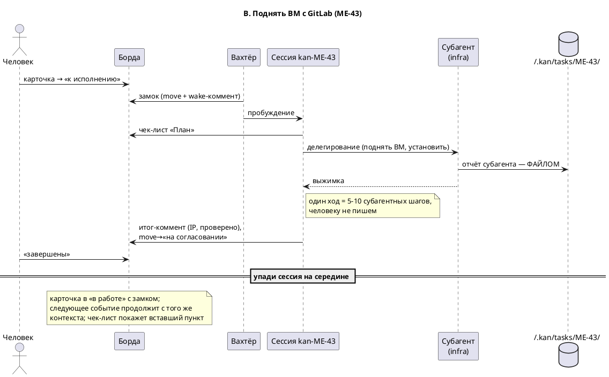
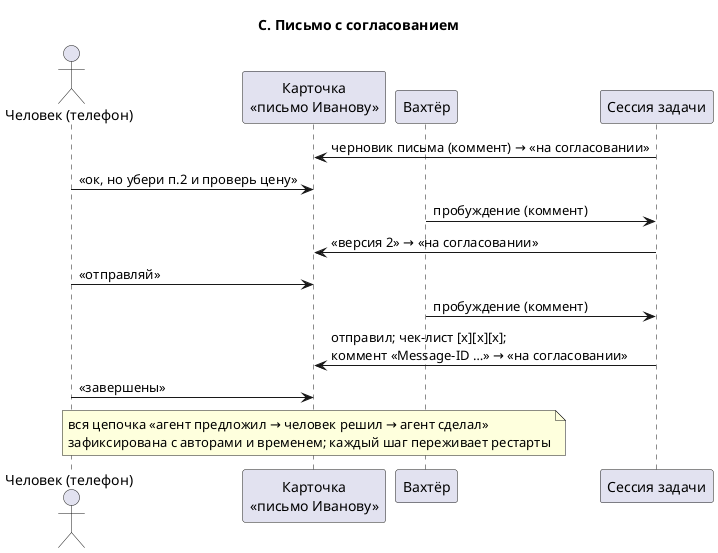
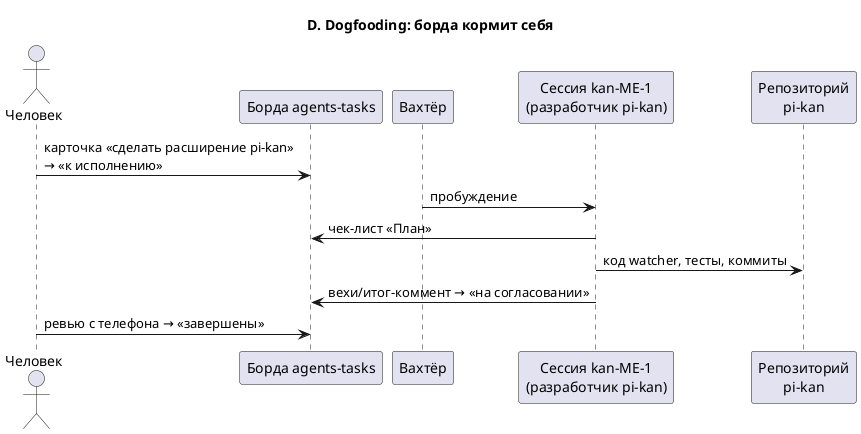

# Показательные сиквенсы

Хронология «как это ощущается» — для проверки архитектуры на живых кейсах
и как онбординг для новых сессий. Все диаграммы — PlantUML.

## A. «Транскрибация встречи» — файл, долгая работа, вопрос «куда»

```plantuml
@startuml
title A. Транскрибация встречи (ME-42)
skinparam participantStyle-> rectangle

actor "Человек (телефон)" as U
participant "Борда Kan.bn" as B
participant "Вахтёр\n(демон, без LLM)" as W
participant "Сессия kan-ME-42\n(агент)" as A
participant "Job\n(ASR/диаризация)" as J
database "~/.kan/tasks/ME-42/" as FS

U -> B : карточка ME-42 + описание;\nфайл в ~/.kan/inbox/;\n→ «к исполнению»
W -> B : поллинг (≤60 с), diff
W -> B : замок: move→«в работе»\n+ коммент wake runId=…
W -> A : spawn pi -p --session-id kan-ME-42\n<контракт + payload «вошла в к исполнению»>
A -> B : create_checklist «План» (3–9 пунктов)
A -> FS : mkdir, забрать файл из inbox
A -> J : запуск фонового job (не держим ход)
A -> B : коммент «запущено, ETA ~40 мин» <!--kan:agent-->
note right of A : ход окончен, процесс умер
J -> B : коммент <!--kan:job-->\n«готово: transcript.md, 4 спикера»
W -> B : diff: job-коммент
W -> A : пробуждение №2 «job завершился»
A -> FS : вычитать transcript.md
A -> B : вопрос «куда сохранять? варианты…»\n+ move→«на согласовании»
note right of A : ждёт хоть неделю — он не процесс
U -> B : коммент «в Meetings/октябрь/,\nзадачи с дедлайнами»
W -> A : пробуждение №3 (человеческий коммент)
A -> B : сохранить транскрипт (NFS);\nчитать борду «Рабочие задачи» (вахтёр её не поллитит);\nсоздать карточки экшенов
A -> B : итог-коммент: путь + ссылки + «Бригада: …»,\nчек-лист ✓, move→«на согласовании»
U -> B : ME-42 → «завершены» (только человек)
note over A : сессия kan-ME-42 — архив задачи:\npi --session-id kan-ME-42 вернёт всю кухню
@enduml
```

## B. «Поднять ВМ с GitLab» — тяжёлая работа через субагента



## C. «Письмо с согласованием» — комменты как аудит-трейл



## D. Собака, которая ест себя (dogfooding)


